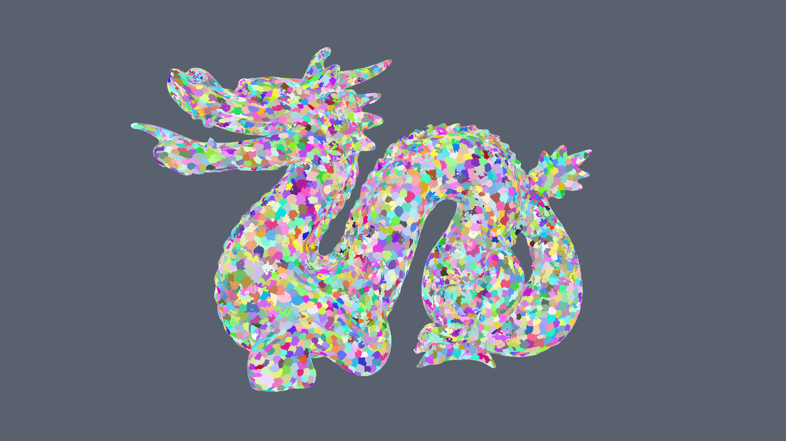
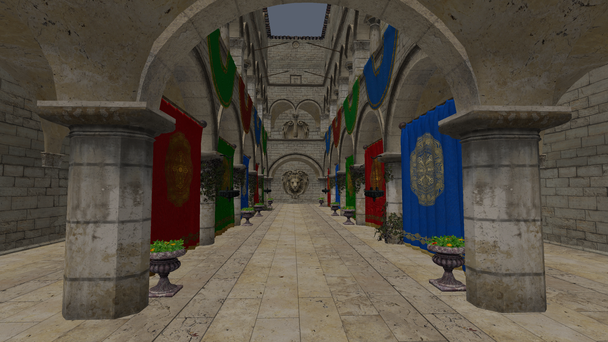
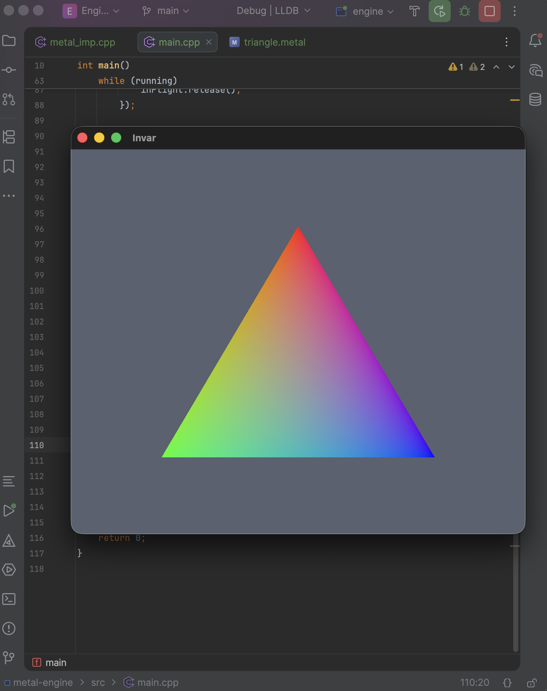
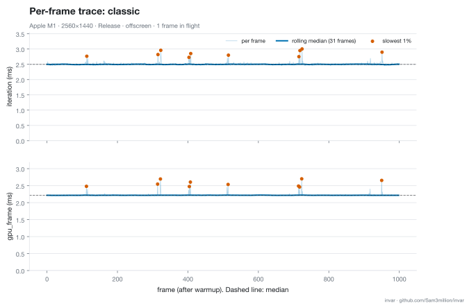
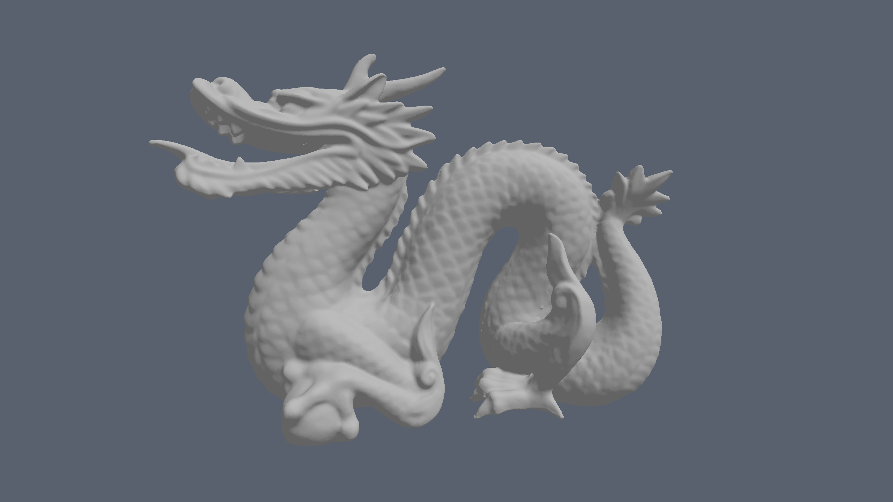
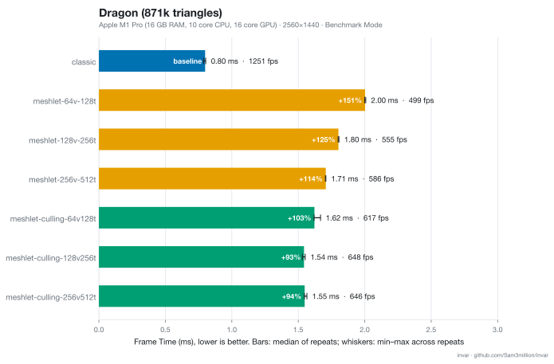
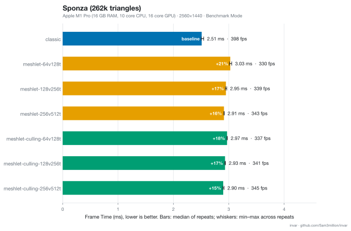
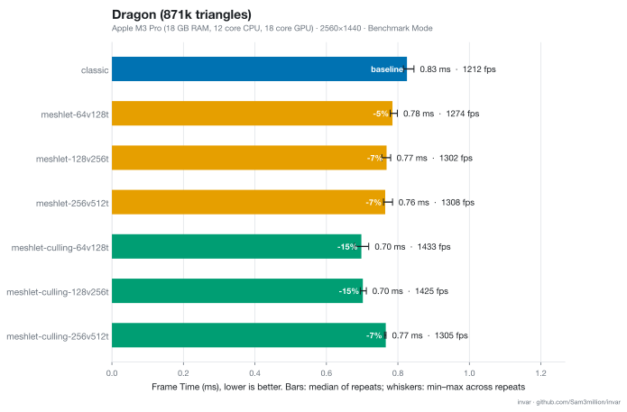
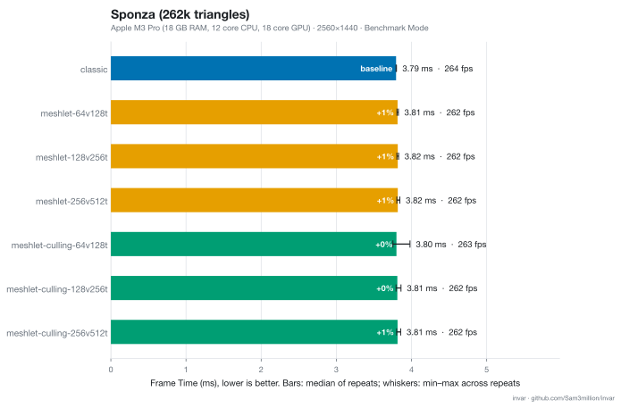

Invar is a from-scratch renderer in C++ and Metal (via metal-cpp) that I built to learn mesh shaders and GPU-side culling on Apple silicon. It renders glTF scenes through three interchangeable paths: a classic vertex pipeline, a meshlet pipeline using mesh shaders, and a meshlet pipeline with frustum and backface-cone culling in an object shader. I benchmarked each path offscreen on an M1 Pro and an M3 Pro. Mesh shading was not automatically faster: on the Stanford Dragon it was up to 2.5× slower than the classic pipeline on the M1 Pro, but roughly 8% faster on the M3 Pro (about 0.76 vs 0.83 ms), and about 16% faster with culling (about 0.70 ms). On Sponza, the paths were within about 16% of each other on the M1 Pro, and tied on the M3 Pro. This post covers the build, the measurements, and what I still need to test.





# Setup

First I set up the project repository layout with directories for src, shaders, build, etc. I used CLion as my IDE for the project, and used CMake to build. Next I installed some third-party libraries, including cgltf (3d model loader), meshoptimizer (meshlet generator), sdl3 (window and input), stb (texture loader), and metal-cpp (Apple's official C++ wrapper for Metal).

After that, the first step was getting metal-cpp set up properly. I created metal_imp.cpp, then populated it as directed by the documentation:

```cpp
#define NS_PRIVATE_IMPLEMENTATION
#define CA_PRIVATE_IMPLEMENTATION
#define MTL_PRIVATE_IMPLEMENTATION
#include <Foundation/Foundation.hpp>
#include <Metal/Metal.hpp>
#include <QuartzCore/QuartzCore.hpp>
```

Next was getting a window going. For that I used sdl3, which is a cross-platform library that supports window creation, input, audio, and more. I created main.cpp, then with a few lines of SDL Initilization code, the window was up and running. After that I setup the metal rendering state (metal device, metal layer, command queue, pipeline state, etc.) and set up a counting semaphore to manage up to 3 frames in flight. I wrote a simple test triangle shader and encoded the draw call to a command buffer. With that we have our first triangle!



# Baseline Renderer

Now I want to get some actual 3D geometry rendering. So, I created structs for a Transform and Camera, and then set up model loading with cgltf. I also implemented basic texturing/material support. This baseline renderer uses standard rendering approaches (i.e. traditional vertex pipeline) so I can compare against it later.


*Sponza Scene*

Since I'm going to be doing lots of performance testing, I wrote a PerformanceCounter class that will help me keep track of frame times. I also created a benchmark mode that will run headless (rendering to an off-screen texture rather than a window) to give repeatable measurements. I can then plot the output gpu/frame time  measurements and compare quantitatively.


*Example Benchmark Data*

# Meshlets and GPU-driven Rendering

In standard rendering, we create vertex and index buffers. Vertices are processed by the vertex shader, which transforms them into clip space. The results of the vertex shader are stored in the post-transform vertex cache. The fragment shader then runs and colors each pixel covered by a triangle.

This works well, but the post-transform vertex cache is often underused if indices are ordered poorly. Since the cache is only so large, if a vertex hasn't been used in a while, it will eventually be evicted. If it is then used later on, the vertex function will have to run again. In addition, we can't easily perform culling, and the culling we can do is usually quite coarse.


*Stanford Dragon rendered with the standard approach*

Modern rendering approaches solve these issues by dividing a mesh into small spatially coherent sections of vertices and triangles called "Meshlets." Meshlet size typically ranges betwen 64 to 256 vertices and 128 to 512 triangles; I tested 64/128, 128/256 and 256/512. The indices are local to each meshlet (meaning they can be just 1 byte each), and the vertices reference the main vertex buffer. This allows for many performance improvements. Aside from potentially better cache utilization, we can also perform GPU culling on entire meshlets, removing them before we do any heavy vertex processing. Meshlets combine nicely with frustum culling, cone culling, and occlusion culling.

For meshlet generation, the de-facto standard is [meshoptimizer](https://github.com/zeux/meshoptimizer). This open-source library has many useful functions for mesh optimization and meshlet building. The main function we need is:
```cpp
size_t meshopt_buildMeshlets(
    meshopt_Meshlet* meshlets, 
    unsigned int* meshlet_vertices, 
    unsigned char* meshlet_triangles, 
    const unsigned int* indices, 
    size_t index_count, 
    const float* vertex_positions,
    size_t vertex_count, 
    size_t vertex_positions_stride,
    size_t max_vertices,
    size_t max_triangles, 
    float cone_weight)
```
which will generate a list of meshlet structs of the form:
```cpp
struct meshopt_Meshlet
{
    /* offsets within meshlet_vertices and meshlet_triangles arrays with meshlet data */
    unsigned int vertex_offset;
    unsigned int triangle_offset;
    
    /* number of vertices and triangles used in the meshlet; data is stored in consecutive range [offset..offset+count) for vertices and [offset..offset+count*3) for triangles */
    unsigned int vertex_count;
    unsigned int triangle_count;
};
```

The `cone_weight` parameter ranges from 0.0-1.0 and specifies how much the meshlets should prioritize surface normal alignment over geometric compactness. A higher value tends to provide better cone-culling results, though with less compact meshlets as a tradeoff, meaning the GPU may have to process more duplicate vertices.

With the meshlets generated, it's just a matter of creating the pipeline state, placing the data into metal buffers, making the appropriate bindings, and performing the draw calls. To cleanly swap between rendering modes for benchmarking, I created an abstract "RenderPath" class that can be extended for each mode. Each child class then has its own implementation of the "encode" function to make the specific bindings and draw calls needed. For mesh shader pipelines, we have to create our pipeline state with a `MeshRenderPipelineDescriptor` rather than the standard `RenderPipelineDescriptor`, and then set the object and mesh shader functions (object shader is optional).


*Stanford Dragon rendered with visualized meshlets*

# Results

I performed benchmarks on the Sponza Scene and the Stanford Dragon Scene in each of 3 different rendering modes (Classic, Meshlets, Meshlets + Culling) and with varying meshlet sizes (64/128, 128/256, and 256/512 Verts and Tris). Each configuration was run 5 times, and each run consisted of 200 warmup frames, then 1000 recorded benchmark frames. The plots below show frame iteration time measurements. That is, the time taken from the start of the frame to the end of the frame. These measurements were performed in benchmark mode (i.e. with the --bench arg), which means 1 frame in flight and rendered to an offscreen texture rather than a screen window. In addition, the meshlets were generated with a cone weight of 0.5. 

I initially measured times that were up to 2.5x slower than the standard rendering approach.





This seemed suspect, as at the very least I expected it to be on par with the classic rendering mode. After some research, I found out that [Apple only introduced hardware accelerated mesh shaders with the M3 chips](https://www.apple.com/newsroom/2023/10/apple-unveils-m3-m3-pro-and-m3-max-the-most-advanced-chips-for-a-personal-computer/). I managed to convince someone I know to let me borrow their M3 Pro Macbook, and I measured the following results.





The dragon results look reasonable. We can see that meshlets alone provide a small speedup, and meshlet culling provides another boost. However the sponza results are strange. The classic rendering is about 3.8 ms, which is significantly slower than the M1 Pro results. In addition, the mesh shader variants produced no improvement.

The M3 Pro slowdown on Sponza may be due to its lower memory bandwidth compared to the M1 Pro (150 GB/s vs 200 GB/s). Since the Sponza scene makes use of many textures, the shader is mostly memory reads. The lack of improvement with meshlets is also understandable, as Sponza isn't the most vertex heavy scene. The M1 Pro meshlet results also saw little change between themselves.

I will try to conduct more benchmarks soon to see if the results are any different. I suppose this also serves as a reminder that it isn't always as clear cut as "mesh shader = performance win." Though I imagine in specific kinds of scenes, mesh shaders will indeed yield a large performance boost.

# Future Work

I plan to use this engine as my playground for trying out different GPU-driven graphics ideas. Features I want to add are:
- Meshlet Occlusion Culling
- Per-Triangle Shadow Volumes
- Ray Tracing
- Realtime Dynamic Global Illumination
- Particle Simulations
- Port of my GPU-driven Grass Project
- Port of my Hyper Marching Cubes Project
- UI with Dear ImGui
- Other engine QOL features

# Repo

All the code for this project can be found at [github.com/Sam3million/invar](https://github.com/Sam3million/invar). It's open source with an MIT license so feel free to play with it. There, you will also find all the benchmark data I collected.