I made an STM32 Flight Controller with an MPU-6050 6 DOF IMU and on-board ILI9341 Display. The firmware runs on an STM32H753ZIT6 microcontroller, interfacing with the IMU via I2C and the display via SPI. I also utilized FreeRTOS to handle multiple tasks (controls, graphics) simultaneously without blocking. The software is meant to be a skeleton that can overriden to perform whatever flight control task needed. For demonstration purposes, I made a 1-axis servo stabilized plate. Full source code is available on [github](https://github.com/Sam3million/STM32-Flight-Controller).

<video width="100%;" autoplay muted controls loop playsinline>
  <source src="/assets/stm32-flight-controller/servo-test.mp4" type="video/mp4">
</video>

## The Hardware
- STM32 Nucleo-H753ZI Development Board
- 2.8" ILI9341 Display with Touch Module
- MPU-6050 6 DOF Inertial Measurement Unit
- Hobby Servo
- Breadboard, Jumper Wires

The heart of the build is the STM32H753ZIT6 microcontroller. It features robust performance with a clock speed of 480 MHz, 1 MB of SRAM and 2 MB of flash program storage. It also features the Chrom-ART accelerator chip, a dedicated 2D graphics hardware engine with support for fill, copy,  pixel format conversion, and alpha blending operations. With these specs, it is more than powerful enough to perform our flight calculations and draw the graphics at the same time.

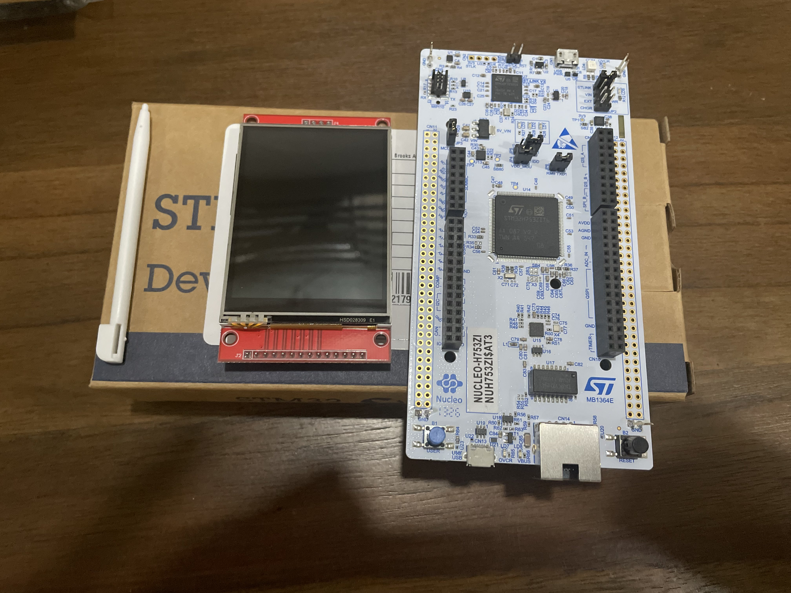
*Nucleo H753ZI Development Board*

I began by configuring the project in STM32CubeMX. This involved setting up the microcontroller clock speed, debug settings, and pins according to the project's needs. After that, I wrote a basic blink-led program to ensure everything was working.

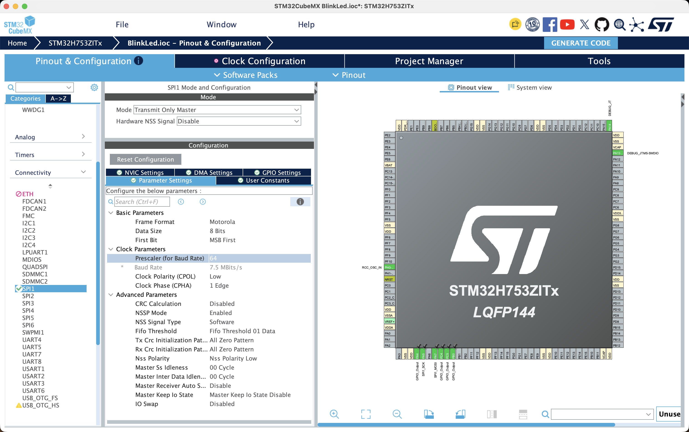
*STM32CubeMX Configuration*

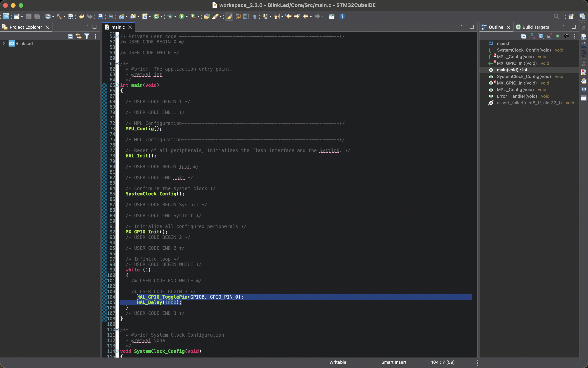
*Generated Project and Blink Code*

<video width="100%;" autoplay muted controls loop playsinline>
  <source src="/assets/stm32-flight-controller/blink.mp4" type="video/mp4">
</video>

# The Display
With the project set up properly, it was time to start coding. The first thing I wanted to handle was the display. Though plenty of ILI9341 driver implementations exist online, I wanted to code it from scratch to understand how it all works.

Referencing the <a href="https://cdn-shop.adafruit.com/datasheets/ILI9341.pdf">ILI9341 datasheet</a>, I made defines for each command, and implemented functions such as SendCommand, SendData, Init, and FillRectangle. This involved setting the appropriate pins high or low, and making the HAL_SPI_Transfer calls.

```c
#include "ili9341.h"

static SPI_HandleTypeDef* displaySPI;
...
void ILI9341_Init(SPI_HandleTypeDef* hspi)
{
	displaySPI = hspi;

	HAL_GPIO_WritePin(LCD_RST_GPIO_Port, LCD_RST_Pin, 0);
	HAL_Delay(10);
	HAL_GPIO_WritePin(LCD_RST_GPIO_Port, LCD_RST_Pin, 1);
	HAL_Delay(120);

	SendCommand(ILI9341_SWRESET);
	HAL_Delay(120);
	SendCommand(ILI9341_SLPOUT);
	HAL_Delay(120);
	SendCommand(ILI9341_COLMOD);
	// 16 bit color format, DBI interface:
	uint8_t colorFormat = 0x05;
	SendData(&colorFormat, 1);
	SendCommand(ILI9341_MADCTL);
	uint8_t madctlFormat = 0b11101000;
	SendData(&madctlFormat, 1);
	SendCommand(ILI9341_DISPON);
}
```

With the basic code in place, the display was working. 

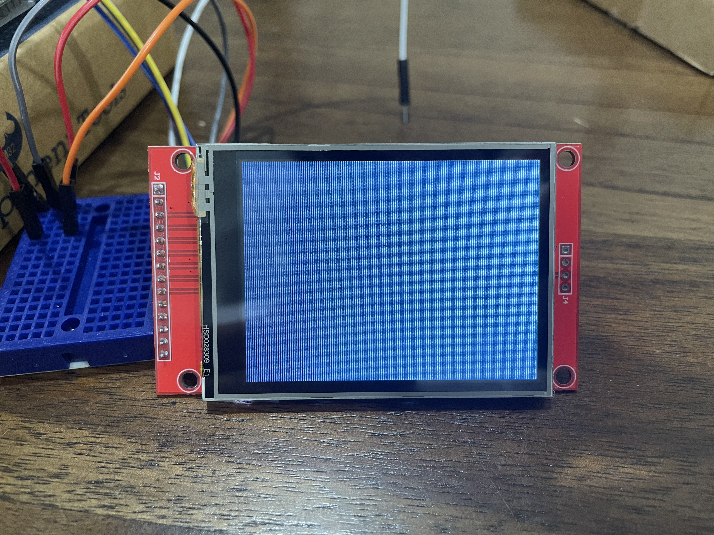

I then drew a couple squares in each corner and played with the MADCTL bits to get the orientation I wanted - (0,0) at top left, (319,0) at top right, (0, 239) at bottom left.

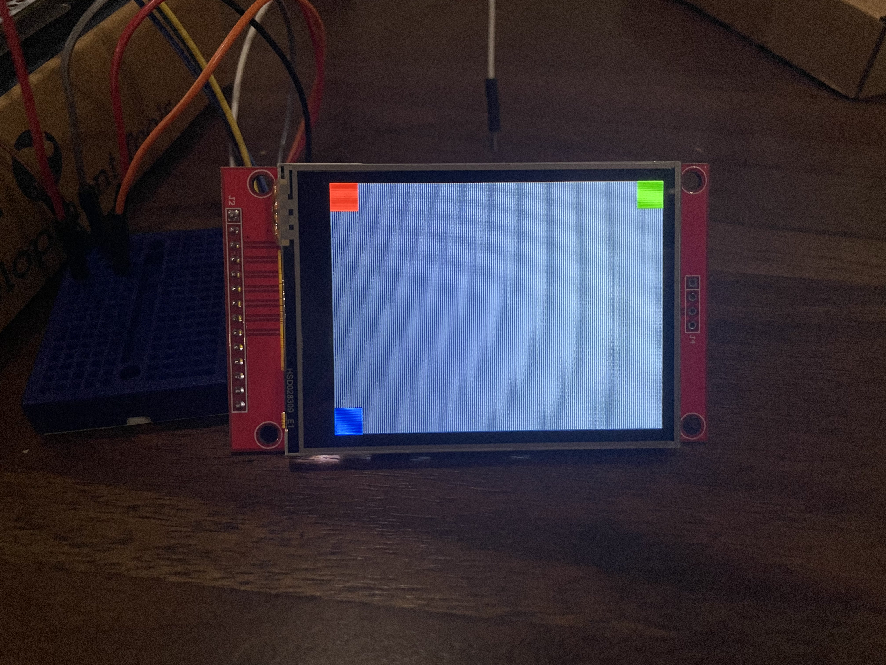

The display was updating very slowly. To diagnose, I wrote a 20 frame fill test, measured the transfer time/speed, and sent the data back to my
laptop over USB with the ST-LINK virtual COM port (USART3 on this board).
The results came out to 3.0 Mbits/s which is exactly what the theoretical rate was configured to by default. To improve the speed, I increased the SPI baud rate in STM32CubeMX.
I performed the fill test again at increasing baud rates. The display stopped updating properly at 48.0 Mbps.

| Baud Rate | Avg. Frame Time |
| :--- | :---: |
| 3.0 Mbps | 411 ms |
| 6.0 Mbps | 206 ms |
| 12.0 Mbps | 103 ms |
| 24.0 Mbps | 85 ms |
| 24.0 Mbps (optimized) | 51 ms |
| 48.0 Mbps | N/A |

As we can see, the frame time halves with each doubling in speed until it gets to 24.0 Mbps. At that point we only get a small improvement.
This indicated that CPU overhead was affecting the time. By setting the -02 compiler flag and enabling Instruction Cache in CubeMX,
I was able to get this down to 51 ms.

Let's compare that final number to the theoretical transfer speed to ensure we're getting maximum performance. The screen is 320x240 with 16 bit color, so 320\*240\*16 bits = 1.2288 Mbits per frame. Our 20 frame test then has 24.576 Mbits of data. So our measured transfer speed is 24.576/1.034 = 23.768 Mbits/s, which is pretty much right at the theoretical rate.

That means that with the display hooked up over SPI, the best we can do is ~20 fps, assuming we're updating the entire frame each time. Solutions for higher framerates include partial screen updates, lowering the color depth, or switching to a parallel display interface (stayed tuned for my FPGA GPU Project).

<video width="100%;" autoplay muted controls loop playsinline>
  <source src="/assets/stm32-flight-controller/fps-test.mp4" type="video/mp4">
</video>

## UI and Text

I added support for bitmap font rendering and wrote DrawChar and DrawString functions. Text can also be scaled up and colored.

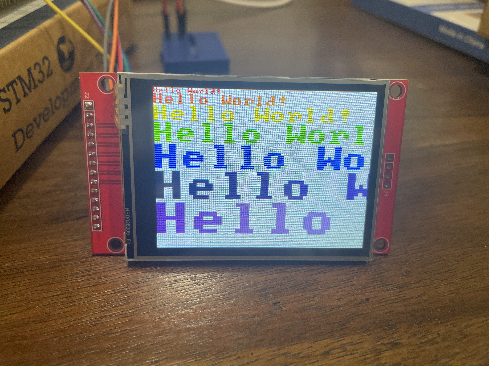

Using Bresenham's algorithms, I implemented drawing of various 2D primitives, including lines, circles, triangles, and rectangles. Most primitives are formed by drawing multiple lines. The primitives can be drawn as wireframes, or can be filled in with a color.

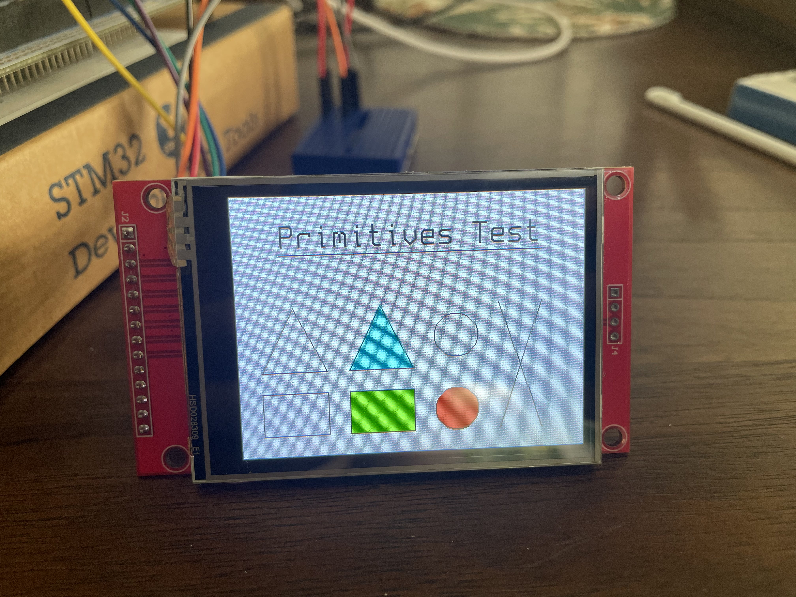

# The Sensors

I soldered connection pins to the MPU-6050 and wired it to the STM32. I had to go back into CubeMX and designate pins for I2C communication.
Then I set up a polling loop and rendered the measurements to the screen. I apply a rolling average to the data to filter out high frequency noise.

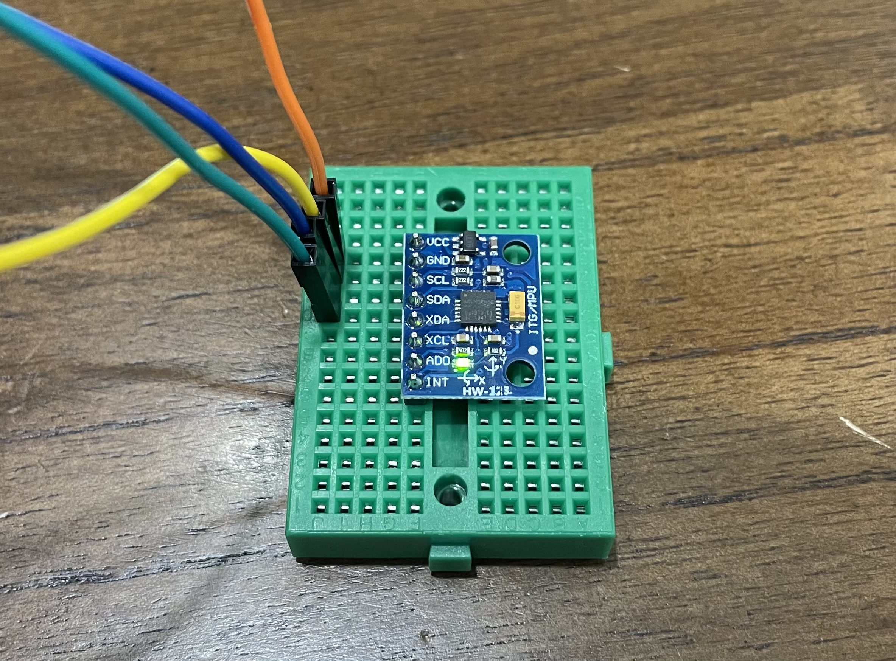

<video width="100%;" autoplay muted controls loop playsinline>
  <source src="/assets/stm32-flight-controller/imu-test-2.mp4" type="video/mp4">
</video>

## Calibration
To calibrate the sensor, I take 100 ms of measurements at startup and average them to calculate offsets. That offset is then subtracted from future measurements.
For the accelerometer, we assume +1.0 g of z acceleration as a baseline.

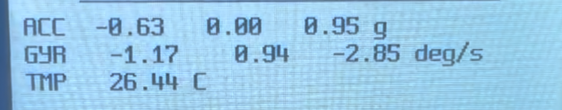
*Before Calibration*

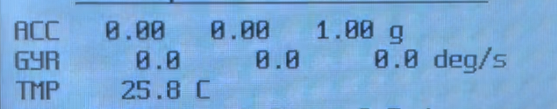
*After Calibration*

## Sensor fusion

With the sensor set up, we can now calculate our roll and pitch angles. This is done using a sensor fusion filter, which combines the data from the gyroscope and accelerometer. Since gyroscopes tend to have low frequency drift, and accelerometers tend to have high frequency noise, combining them produces stable roll and pitch measurements. The idea is that the errors from each will cancel out with each other. I implemented two types of control filters. Both filters involve integration
of the gyro data, which meant I needed an accurate delta time measurement. To achieve this, I configured a hardware timer in CubeMX with a rate of 1 MHz.

### Complementary Filter
Complementary filters are fast and simple, making them suited for MCUs with minimal computational power. We integrate the gyro angular velocity to get delta angles, add that to our previous state, then linearly combine that with the instantaneous angles computed from the accelerometer readings. The output is heavily biased towards the gyro readings, since those are more accurate in the short term.
```c
float2 MPU6050_AccelAttitude(float3 accel)
{
    float2 accelAttitude;
    accelAttitude.x = atan2f(-accel.y, accel.z) * RAD2DEG;
    accelAttitude.y = atan2f(-accel.x, sqrt(accel.y * accel.y + accel.z * accel.z)) * RAD2DEG;
    return accelAttitude;
}

void MPU6050_ComplementaryFilter(Attitude* attitude, float3 accel, float3 gyro, float dt)
{
    float2 accelAttitude = MPU6050_AccelAttitude(accel);
    const float alpha = 0.98f;
    attitude->roll = alpha * (attitude->roll - gyro.x * dt) + (1.0f - alpha) * accelAttitude.x;
    attitude->pitch = alpha * (attitude->pitch + gyro.y * dt) + (1.0f - alpha) * accelAttitude.y;
}
```

This gives great results given the simplicity. Fast movements cause a temporary offset, but it eventually corrects itself.

<video width="100%;" autoplay muted controls loop playsinline style="margin-bottom: 15px;">
  <source src="/assets/stm32-flight-controller/complementary-filter.mp4" type="video/mp4">
</video>

### Kalman Filter
The Kalman filter is a bit more complex. It keeps track of dynamic error and gain terms that change the weighting of the accelerometer and gyro measurements in the final output. This helps it handle sudden bumps and sensor noise much better. I implemented both a one-state and two-state kalman filter.

<video width="100%;" autoplay muted controls loop playsinline>
  <source src="/assets/stm32-flight-controller/kalman-filter.mp4" type="video/mp4">
</video>

# FreeRTOS

I wanted to separate the heavy display drawing tasks from the sensor reading and processing tasks. For this, I used FreeRTOS, which is a lightweight operating system kernel that allows you to schedule and manage independent tasks. Before doing so, I collected frametime data as a baseline.

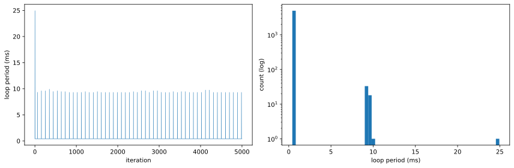
*Frametime baseline before FreeRTOS*

Plotting it out, we can see spikes from the display update that runs every 50 ms. I measured the duration of 200 display updates, and found a median duration of 8.88 ms. This is bad as it means our sensor reading and filtering code is being blocked for a significant amount of time.

<div style="display: flex; justify-content: center;">
<table style="margin: 0 auto;">
  <tr>
    <th colspan="7" style="text-align: center;"><strong>Display Update Duration</strong></th>
  </tr>
  <tr>
    <th style="text-align: right;">Mean</th>
    <th style="text-align: right;">Std Dev</th>
    <th style="text-align: right;">Min</th>
    <th style="text-align: right;">Med</th>
    <th style="text-align: right;">99%</th>
    <th style="text-align: right;">99.9%</th>
    <th style="text-align: right;">Max</th>
  </tr>
  <tr>
    <td style="text-align: right;">9.03 ms</td>
    <td style="text-align: right;">1.11 ms</td>
    <td style="text-align: right;">8.87 ms</td>
    <td style="text-align: right;">8.88 ms</td>
    <td style="text-align: right;">9.32 ms</td>
    <td style="text-align: right;">21.53 ms</td>
    <td style="text-align: right;">24.52 ms</td>
  </tr>
</table>
</div>

To enable FreeRTOS, first we enable the option in CubeMX under middleware. Then we have to change the SYS Timebase Source to use something other than SysTick to prevent conflicts between the OS and the STM32 HAL library. Then I created 3 tasks for Controls, Display, and Telemetry, and configured their priority, stack size, and entry function. I set the control task as high priority, the display task as below-normal priority, and the telemetry task as low priority. Next I changed some FreeRTOS config settings, including the heap size (increase from 15 KB to 32 KB), set CHECK_FOR_STACK_OVERFLOW to Option 2, and enabled USE_MALLOC_FAILED_HOOK. Finally, I added a mutex to be able to share certain data between tasks.

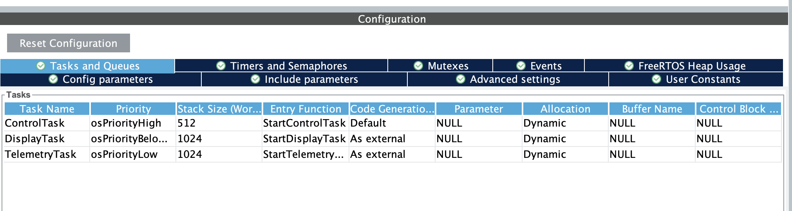
*FreeRTOS Task Configuration*

After regenerating, I split up the code and moved pieces into the appropriate tasks. The sensor reading and filtering code went into the control task, the display update code went into the display task, and the UART telemetry output code went into the telemetry task. The mutex controls access to data shared between the three tasks.

```c
void ControlTask_Run(void* argument)
{
	Attitude attitude = {0};
	float3 accel, gyro;
	float temperature;

	uint32_t next = osKernelGetTickCount();
	uint32_t lastUs = __HAL_TIM_GET_COUNTER(&htim2);
	for (;;)
	{
		next += 1;

		MPU6050_GetSensorData(&accel, &temperature, &gyro);

		uint32_t nowUs = __HAL_TIM_GET_COUNTER(&htim2);
		float dt = (float)(nowUs - lastUs) * 0.000001f;
		lastUs = nowUs;

		FILTER_UPDATE(&attitude, accel, gyro, dt);

		osMutexAcquire(sharedMutexHandle, osWaitForever);
		sharedState.attitude = attitude;
		SensorAverage_Add(&sharedState.average, accel, gyro, temperature);
		osMutexRelease(sharedMutexHandle);

		// if we ran late, don't try to catch up, just reset the schedule:
		if (osDelayUntil(next) != osOK) next = osKernelGetTickCount();
	}
}
```

With FreeRTOS implemented, the spikes were removed completely. The control task runs at 1000 Hz, and the display task at around 50 Hz.
<!-- put dt plot after changing to freertos here -->

# Telemetry Stream

To better visualize the attitude data and compare the filter types, I implemented telemetry streaming over UART. The STM32 writes data to UART3 (which goes through the nucleo's usb connection) in the telemetry stream task, then a python program plots the data live. The following video shows the plotted roll angle, separated by filter type.

<video width="100%;" autoplay muted controls loop playsinline>
  <source src="/assets/stm32-flight-controller/telemetry-demo.mp4" type="video/mp4">
</video>

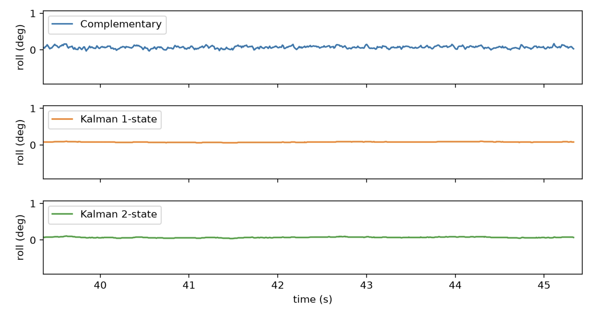
*Filter comparison*

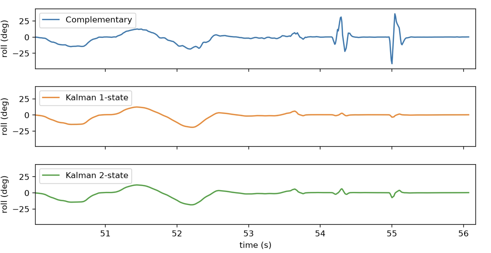
*Complementary filter has larger spikes*

You can see how the complementary filter is more jagged and has larger spikes with sudden movements. The Kalman filters are much smoother. It's hard to tell a difference between the 1-state and 2-state Kalman filters though. Perhaps real-world situations might reveal a larger difference.

# Servo Test

With the software mostly done, I wanted to test it out on some hardware. First I made a simple servo-plate bench test, and swept the servo through a +/- 20 degree roll angle.

<video width="100%;" autoplay muted controls loop playsinline>
  <source src="/assets/stm32-flight-controller/servo-test.mp4" type="video/mp4">
</video>

# PID Stabilized Plate Demo

The final test is a 1-axis stabilized plate. This is just for demonstration purposes, and a real flight control loop could be substituted here. The PID runs at 100 Hz inside the 1 kHz control task. The derivative term uses the gyro rate directly instead of differentiating the angle, and the integral and output are both clamped.

<video width="100%;" autoplay muted controls loop playsinline>
  <source src="/assets/stm32-flight-controller/pid-test.mp4" type="video/mp4">
</video>

# Conclusion

I wrote a display driver from scratch, read an IMU over I2C, and compared a complementary filter against one-state and two-state Kalman filters on the same data. Adding FreeRTOS fixed the problem I could measure, which was the 9 ms stalls the display put into the control loop.

The most useful habit was measuring before changing anything. The SPI clock, the loop timing, and the filters’ time constants all behaved differently from what I assumed until I plotted them. The sign conventions for roll and the dependence of filter tuning on loop rate cost me the most time.

The rig controls one axis, has no magnetometer so it cannot track yaw, and still polls the I2C bus. The next steps are a second servo for pitch, a data-ready interrupt with DMA for the sensor, and improved graphics for visualization.

# Source Code

See the full source code for this project at [github.com/Sam3million/STM32-Flight-Controller](https://github.com/Sam3million/STM32-Flight-Controller).